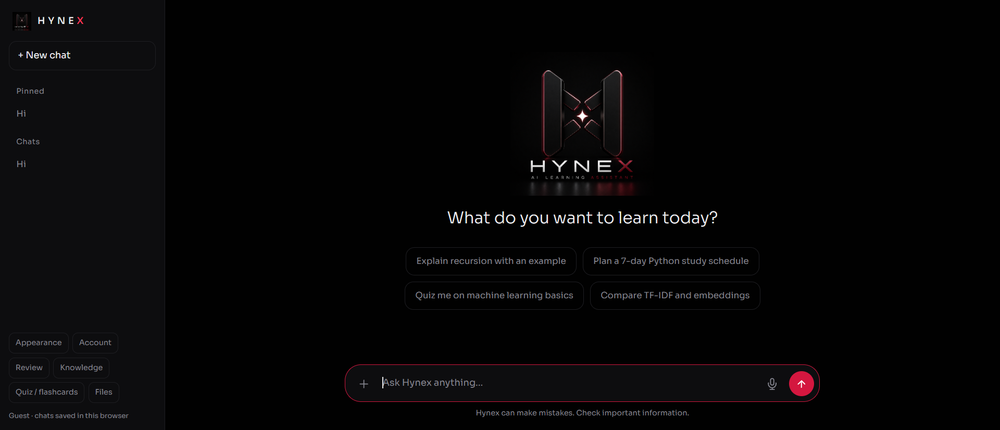
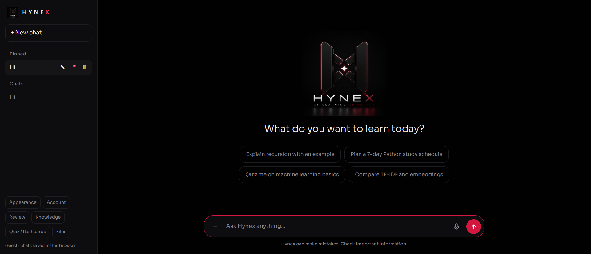

# Hynex — AI Learning Assistant

Hynex is a web-based learning assistant built with FastAPI and the Gemini API. It combines conversational answers with file summaries, quizzes, flashcards and tools for organising study chats.

Created by **Harshita Nayan** as part of the **Invoqe AI/ML Developer internship — AI Chatbot & NLP System**.

## Preview

### Learning interface



### Chat controls

Rename, pin or unpin, and delete chats directly from the sidebar.



## Features

- **AI chat:** streamed Gemini responses, recent conversation context, Markdown formatting and copyable code blocks.
- **Chat management:** create multiple chats, rename them, pin favourites and delete chats with confirmation.
- **File attachments:** attach PDFs, TXT/Markdown notes and PNG/JPG/WEBP images using the **+** button. Ask questions about selected files or request a summary from **Files**.
- **Voice input:** use the microphone to dictate a message, review the text and send it. Requires a browser that supports speech recognition and microphone permission.
- **Quizzes and flashcards:** generate multiple-choice quizzes with grading, or flashcards for revision.
- **Appearance:** switch between light and dark modes and choose an accent colour.
- **Accounts and saved chats:** local username/password accounts, server-side chat storage and account chat synchronisation. Guests retain chats in their browser.
- **Google sign-in:** optional Google OpenID Connect login, enabled after configuring OAuth credentials. Google handles its own account and password entry.
- **Access control:** backend ownership checks for private account data and an optional setting to require login.
- **Knowledge retrieval:** search local study notes using TF-IDF and LSA-based similarity, with retrieved sources available for inspection.
- **Answer review:** submit feedback and compare an answer with reference text using token overlap. This score measures wording overlap, not factual accuracy.
- **Offline fallback:** a local TF-IDF intent matcher provides limited responses when Gemini is unavailable.
- **Creator identity:** direct questions about who created Hynex identify **Harshita Nayan**.

## How it works

1. Enter a question, dictate it or attach study material.
2. The backend retrieves relevant local notes and includes selected file content and recent chat history where applicable.
3. Gemini generates an answer that streams into the interface. If the service is unavailable, the app can use its limited local intent matcher.
4. Use the study tools to generate quizzes, revise with flashcards or summarise files.

## Tech stack

**Backend:** Python, FastAPI, Uvicorn, SQLite, scikit-learn, Gemini API, google-auth, pypdf and Pillow.

**Frontend:** HTML, CSS, JavaScript and browser speech recognition.

## Run locally

Clone the repository and install dependencies:

```bash
git clone https://github.com/HarshitaNayan/Invoqe_AIChatbot.git
cd Invoqe_AIChatbot
python -m pip install -r requirements.txt
```

Create a `.env` file in the project root with your Gemini API key:

```dotenv
GEMINI_API_KEY=your_api_key_here
GEMINI_MODEL=gemini-2.5-flash
```

Start the development server:

```bash
python -m uvicorn app.main:app --reload
```

Open **http://127.0.0.1:8000** in your browser.

For Google sign-in configuration, see [GOOGLE_SIGN_IN_SETUP.md](GOOGLE_SIGN_IN_SETUP.md). A Gemini API key and Google OAuth credentials serve different purposes. Set `HYNEX_REQUIRE_LOGIN=1` in `.env` if all users must sign in.

Keep `.env` and the private `runtime/` database out of Git. Hosted accounts require persistent storage; public deployment requires HTTPS and appropriate OAuth configuration.

## Project files

| Location | Purpose |
| --- | --- |
| `app/main.py` | FastAPI application and chat endpoint |
| `app/llm.py` | Gemini requests and streamed responses |
| `app/chatbot.py`, `app/preprocess.py` | Local intent matching and text processing |
| `app/extensions.py` | Additional feature endpoints |
| `app/retrieval.py` | Local knowledge retrieval |
| `app/uploads.py` | File validation and extraction |
| `app/storage.py`, `app/google_login.py` | Accounts, persistence and Google login |
| `app/identity.py`, `app/quality.py` | Creator responses and answer comparison |
| `data/intents.json`, `data/knowledge/` | Local intents and study notes |
| `static/` | Interface, feature scripts, styles and branding |
| `tests/` | Automated backend tests |

## Limitations

- AI answers can be incorrect; check important information.
- Gemini-dependent tools require an API key and available quota. Offline mode provides basic intent responses only.
- Voice input depends on browser support and is speech-to-text, not a live voice conversation.
- Scanned PDFs may not provide extractable text; attach an image for image-based questions.
- Google login needs OAuth configuration. Local accounts currently have no password recovery or email verification.
- LSA retrieval uses a local statistical representation, rather than a neural embedding service.

## Author

**[Harshita Nayan](https://github.com/HarshitaNayan)**
